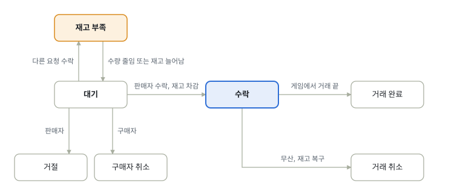

# Tradepost

게임 내 거래를 소재로 한 **거래 요청 사이트**입니다.
판매자가 아이템과 재고를 올리면, 구매자는 수량을 정해 구매 요청을 보내고, 판매자가 수락하거나 거절합니다.
실제 결제와 물건 전달은 게임 안에서 게임 화폐로 진행하며, 이 사이트는 요청과 알림만 다룹니다.

## 주요 기능

- **디스코드 로그인**: 디스코드 계정으로 로그인하고 게임 닉네임을 등록
- **판매자 승인제**: 판매 신청 → 관리자 승인 후 판매자 권한 부여
- **상품 등록**: 아이템 목록에서 선택(없으면 직접 입력), 판매 단위(낱개 또는 묶음 단위), 단위당 가격, 재고
- **구매 요청**: 수량을 정해 요청, 판매자가 수락 / 거절
- **재고 관리**: 수락 시점에 재고 차감, 거래 취소 시 복구, 동시 수락에도 재고가 음수가 되지 않도록 처리
- **알림**: 판매자는 디스코드 웹훅, 모든 알림은 사이트 알림함에도 기록

## 거래 흐름

## 기술 스택

| 영역 | 기술 |
| --- | --- |
| Backend |      |
| Frontend |   |
| Database |   |
| Auth |  |
| Build |  |
